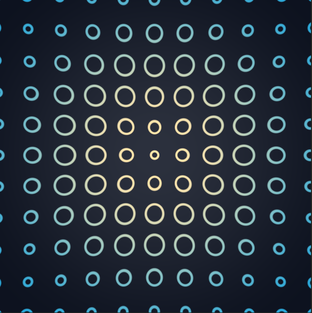
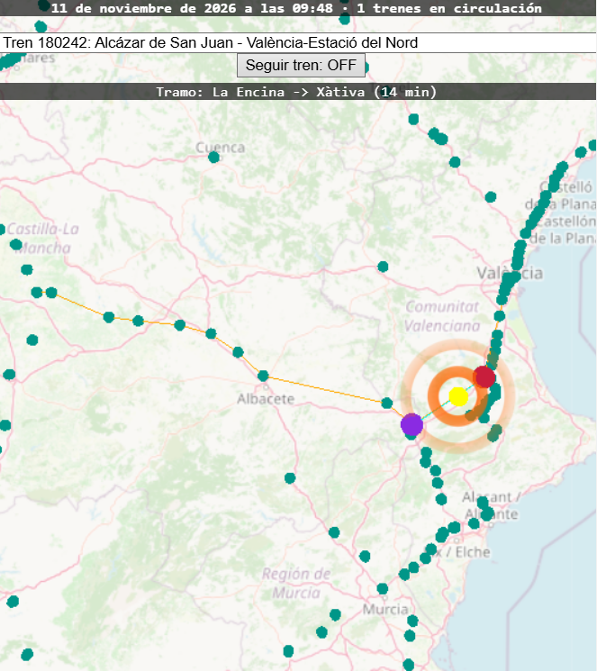

# Shaders de Fragmentos

### **Autor: Yenedey Morán Delgado, https://github.com/Yenedey36**




## 1. Motivación

El objetivo de esta práctica es desarrollar un shader de fragmentos en **GLSL** que combine la generación procedimental de patrones geométricos con un comportamiento dinámico e interactivo.

A nivel visual, la propuesta toma inspiración del arte cinético y el *Op-Art* de **Victor Vasarely**, donde una repetición ordenada de formas geométricas simples genera una sensación de profundidad y movimiento tridimensional al alterar localmente sus proporciones. Para evitar combinaciones cromáticas estridentes, se ha diseñado una paleta sobria de tres tonos (azul noche para el fondo, azul océano para las formas en reposo y dorado cálido para la zona activa) que responde en tiempo real a la posición del puntero (`u_mouse`) y al paso del tiempo (`u_time`).

---

## 2. Desarrollo Paso a Paso

El desarrollo del algoritmo se divide en cinco etapas fundamentales dentro del shader de fragmentos:

### Paso 1: Normalización y corrección de relación de aspecto
Para evitar que los círculos de la rejilla se deformen como elipses cuando la ventana no es cuadrada, dividimos tanto las coordenadas del fragmento (`gl_FragCoord.xy`) como las del ratón (`u_mouse`) únicamente por la altura de la ventana (`u_resolution.y`):
```glsl
vec2 R = u_resolution;
vec2 st = gl_FragCoord.xy / R.y;
vec2 m = u_mouse / R.y;
```

### Paso 2: Campo de distancias y onda expansiva
Calculamos la distancia euclídea `d` desde cada píxel hasta la posición actual del cursor con la función `distance(st, m)`. A partir de esta distancia generamos dos variables:
* **`onda`**: Una función sinusoidal desfasada por el tiempo (`sin(d * 10.0 - u_time * 3.0)`) que crea ondas concéntricas propagándose desde el ratón.
* **`cercania`**: Un factor suavizado con `smoothstep(0.7, 0.0, d)` que vale `1.0` justo debajo del cursor y decae suavemente a `0.0` al alejarse, utilizado para modular el color y la iluminación.

### Paso 3: Deformación espacial (Efecto lente) y subdivisión en rejilla
Antes de subdividir el espacio en celdas, alteramos las coordenadas `st` sumando un vector de desplazamiento radial inversamente proporcional a la distancia al ratón:
```glsl
vec2 desplazamiento = (st - m) / (d + 0.2) * 0.08;
vec2 celda = fract((st + desplazamiento) * 9.0) - 0.5;
```
Al multiplicar por `9.0` y quedarnos con la parte fraccionaria mediante `fract()`, replicamos el espacio en una cuadrícula de celdas independientes y centramos el origen `(0.0, 0.0)` de cada celda restando `0.5`.

### Paso 4: Trazado procedimental de anillos dinámicos
En cada celda dibujamos un anillo cuyo radio base (`0.22`) se expande y contrae al ritmo de la onda (`0.1 * onda`). Para obtener bordes suaves sin *aliasing*, combinamos la distancia al centro de la celda (`length(celda)`), el valor absoluto `abs()` y la función `smoothstep()`:
```glsl
float radio = 0.22 + 0.1 * onda;
float anillo = smoothstep(0.06, 0.02, abs(length(celda) - radio));
```

### Paso 5: Mezcla cromática e iluminación
Finalmente, utilizamos la función `mix()` para interpolar los colores de forma continua:
1. Mezclamos el color frío de los anillos lejanos con el tono dorado cálido en función de la variable `cercania`.
2. Mezclamos el color de fondo con el color del anillo usando la máscara geométrica `anillo`.
3. Añadimos un ligero halo ambiental (`cercania * 0.12`) alrededor del cursor para reforzar el efecto de foco luminoso.

---

## 3. Código del Shader (Editor *The Book of Shaders*)

### Versión 1: Código legible y comentado

```glsl
#ifdef GL_ES
precision mediump float;
#endif

uniform vec2 u_resolution;
uniform vec2 u_mouse;
uniform float u_time;

void main() {
    // 1. Coordenadas normalizadas corrigiendo la relacion de aspecto
    vec2 R = u_resolution;
    vec2 st = gl_FragCoord.xy / R.y;
    vec2 m = u_mouse / R.y;

    // 2. Distancia al cursor, onda temporal y factor de cercania
    float d = distance(st, m);
    float onda = sin(d * 10.0 - u_time * 3.0);
    float cercania = smoothstep(0.7, 0.0, d);

    // 3. Efecto lente magnetica y creacion de la rejilla con fract()
    vec2 desplazamiento = (st - m) / (d + 0.2) * 0.08;
    vec2 celda = fract((st + desplazamiento) * 9.0) - 0.5;

    // 4. Anillo procedimental con radio dinamico y bordes suavizados
    float radio = 0.22 + 0.1 * onda;
    float anillo = smoothstep(0.06, 0.02, abs(length(celda) - radio));

    // 5. Paleta de colores y mezcla final
    vec3 colorFondo = vec3(0.05, 0.07, 0.12);
    vec3 colorLejos = vec3(0.15, 0.65, 0.85);
    vec3 colorCerca = vec3(0.95, 0.80, 0.55);

    vec3 colorForma = mix(colorLejos, colorCerca, cercania);
    vec3 color = mix(colorFondo, colorForma, anillo) + cercania * 0.12;

    gl_FragColor = vec4(color, 1.0);
}
```

### Versión 2: Código minificado — Reto *Tiny Code* (495 bytes < 512 bytes)

Esta versión reduce los nombres de variables, agrupa declaraciones `uniform` y elimina espacios innecesarios para ocupar únicamente **445 bytes** (incluyendo directivas de precisión y `uniforms`), siendo directamente ejecutable en [editor.thebookofshaders.com](https://editor.thebookofshaders.com/):

```glsl
#ifdef GL_ES
precision mediump float;
#endif
uniform vec2 u_resolution,u_mouse;
uniform float u_time;
void main(){
vec2 R=u_resolution,st=gl_FragCoord.xy/R.y,m=u_mouse/R.y;
float d=distance(st,m),w=sin(d*10.-u_time*3.),p=smoothstep(.7,0.,d);
vec2 f=fract((st+(st-m)/(d+.2)*.08)*9.)-.5;
float s=smoothstep(.06,.02,abs(length(f)-.22-.1*w));
vec3 c=mix(vec3(.05,.07,.12),mix(vec3(.15,.65,.85),vec3(.95,.8,.55),p),s);
gl_FragColor=vec4(c+p*.12,1.);
}
```

---

## 4. Integración en Three.js

El shader también se ha integrado dentro del entorno de **Three.js** (`script.js`) empleando un `THREE.ShaderMaterial` sobre un plano (`PlaneBufferGeometry`). Dado que en el script base de Three.js el evento `onmousemove` envía las coordenadas del ratón normalizadas en el rango `[0, 1]` y con el eje vertical invertido respecto a OpenGL, en la versión de Three.js se adapta la lectura del puntero mediante `vec2 m = vec2(u_mouse.x, 1.0 - u_mouse.y) * R / R.y;`.

---

## 5. Referencias

* **Guion de Prácticas de Informática Gráfica (ULPGC)** — Sesión 9: *Shaders (Introducción a GLSL, Patrones, Generativos y Efectos inspirados en Vasarely)*.
* **Three.js Documentation** — *ShaderMaterial*. Disponible en: https://threejs.org/docs/#api/en/materials/ShaderMaterial

---

## **Enlace al CodeSandbox: https://codesandbox.io/p/sandbox/ig-s9-forked-lv287s**


# Extra: Integración de Shader en Práctica S8 (Simulador Ferroviario 3D)




Como ampliación de la práctica, se ha integrado un `THREE.ShaderMaterial` personalizado dentro del proyecto de visualización de datos de Renfe (**S8**):
* **Repositorio con la integración:** `https://github.com/Yenedey36/simulador-renfe-3d`

### Motivación y Funcionamiento
Para destacar visualmente sobre el mapa peninsular la estación inspeccionada o el tren en seguimiento activo, se ha creado un plano con transparencia (`transparent: true`) sobre el que se ejecuta un shader de fragmentos que genera ondas de radar concéntricas animadas:

```glsl
uniform float u_time;
uniform vec3 u_color;
varying vec2 vUv;

void main() {
  float d = distance(vUv, vec2(0.5));
  float onda = sin(d * 35.0 - u_time * 4.0);
  float anillo = smoothstep(0.1, 0.5, onda) * smoothstep(0.5, 0.05, d);
  gl_FragColor = vec4(u_color, anillo * 0.85);
}
```

* **Cálculo de ondas:** A partir de las coordenadas de textura `vUv` enviadas desde el vertex shader, se calcula la distancia radial al centro del plano (`vec2(0.5)`) y se modula con una función sinusoidal desplazada por `u_time`.
* **Atenuación suave (Alpha blending):** Se multiplican dos funciones `smoothstep` para perfilar los anillos y desvanecer su opacidad suavemente hacia el borde exterior del plano, evitando cortes rectangulares sobre el mapa.
* **Respuesta al estado:** A través del `uniform vec3 u_color`, el shader cambia dinámicamente a verde (`0x00ff88`) al inspeccionar los horarios de una estación y a naranja (`0xffaa00`) al acoplarse a la posición interpolada de un tren en ruta.
